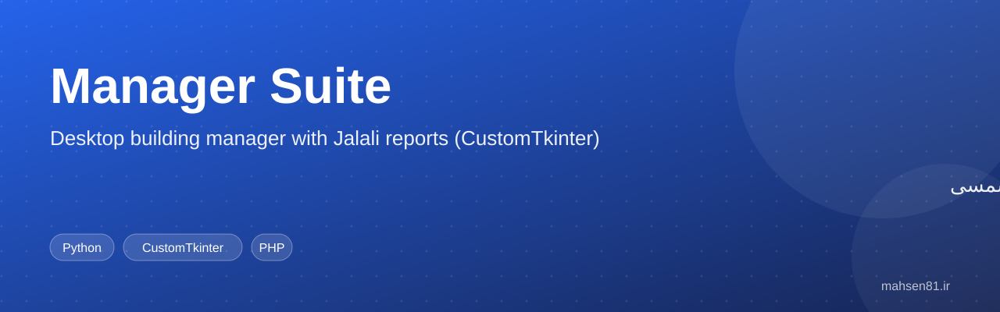

<!-- gen:header -->
<p align="center"></p>

<h1 align="center">Manager Suite</h1>
<p align="center"><b>نرم‌افزار دسکتاپ مدیریت ساختمان و گزارش‌گیری شمسی</b><br><i>Desktop building manager with Jalali reports (CustomTkinter)</i></p>
<p align="center">  </p>

<div dir="rtl">

## ✨ امکانات

- مدیریت ساختمان و شارژ
- گزارش HTML با تاریخ شمسی
- ماژول گیم‌کارت تحت وب

</div>

## 🚀 Quick start

```bash
pip install customtkinter persiantools
python main.py
```

---

<p align="center">ساخته‌شده توسط <a href="https://mahsen81.ir"><b>محسن جباره‌اصل</b></a> — برنامه‌نویسی، طراحی سایت، ربات و هوش مصنوعی<br>
Built by <a href="https://mahsen81.ir">Mohsen Jabbareh-Asl</a> · ⭐ اگر مفید بود، ستاره بدهید · Need a custom version? <a href="https://mahsen81.ir">Get in touch</a></p>
